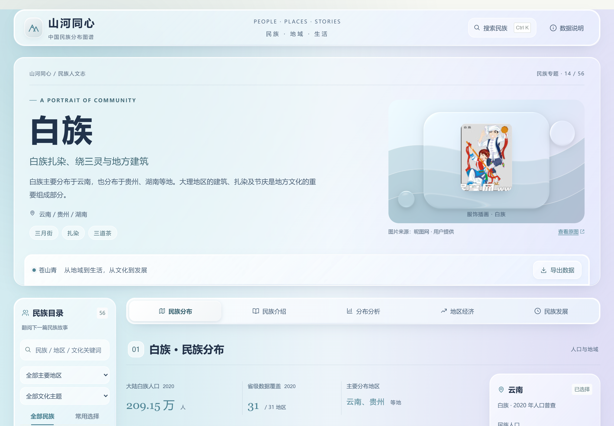
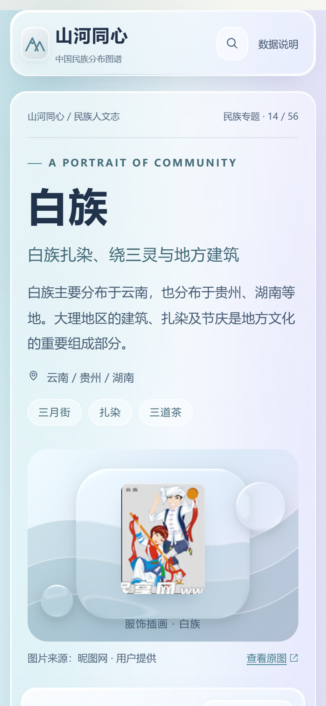

# 液态玻璃界面

本版于2026-10-28将页面更新为液态玻璃风格，继续保留五章节的一族一页结构、原有数据口径、民族搜索及56套主题色。

## 来源

- 用户指定参考：[Liquid Glass Design Systems](https://ruiqichenbiec.github.io/design-systems/)。
- 本地参考项目：`D:/lyn/program/geoask/web` 的 `glass.css`、`glass.js` 和 `vendor/lens/`。
- Lens 上游：[ruiqichenbiec/design-systems](https://github.com/ruiqichenbiec/design-systems)，版本 `1.1.0-showcase.1`，提交 `7a424c93b9be13cf835b91ea67495fec2ec0584e`。
- 实际使用的渲染器、光学参数、显卡资源管理和 tokens 原样存于 `src/vendor/lens/`，附完整 MIT 许可证，Copyright (c) 2026 DayDreamInAReverie。第三方目录不参与项目 Prettier 格式化。

## 效果和清晰度

`GlassArtwork.vue` 在封面头像后方绘制一个主题色场景，使用原始 Lens WebGL2 渲染器折射场景纹理。它不截取网页 DOM，也不模糊前景文字。头像、标题、正文、地图和图表由原有组件继续渲染。

页头、民族目录、页内导航和面板采用 CSS 透明层、内侧高光、投影和 `backdrop-filter`。指针高光由 `useGlassLight.ts` 委托监听，不给大量按钮分别绑定事件，也不使文字弹跳变形。

字号基础值在 `styles/foundation.css`：正文16px、小字14px、图注12px。主要界面覆盖规则集中在最后加载的 `styles/glass.css`。表格增加底色和文字对比度，手机导航横向滚动，长表格在自身容器内滚动。

原头像只有100×132像素，现按桌面120px宽、手机100px宽显示；未伪造高清图片，也未替换原始素材。

## 性能和回退

- 仅封面装饰使用一个 WebGL2 上下文，文字和地图不经过玻璃渲染器。
- 不启用持续场景动画；原始渲染器通过可见性观察器按需绘制，离屏暂停，卸载释放观察器及上下文。
- WebGL2不可用或上下文丢失时，封面仍有 CSS 渐变与玻璃层，搜索、地图及数据模块继续工作。
- `prefers-reduced-transparency: reduce` 关闭封面显卡效果，并将主要面板切为实色。
- `prefers-reduced-motion: reduce` 禁用指针高光更新和过渡；系统高对比度下使用系统颜色并隐藏装饰。

## 检查

执行 `npm run verify`。原有浏览器测试继续验证数据、地图、56民族切换和导航；`tests/browser/glass.spec.ts` 另外覆盖高像素密度、360/390/1024/1920px布局、缺少WebGL2、封面重新挂载以及减少透明度设置切换。

